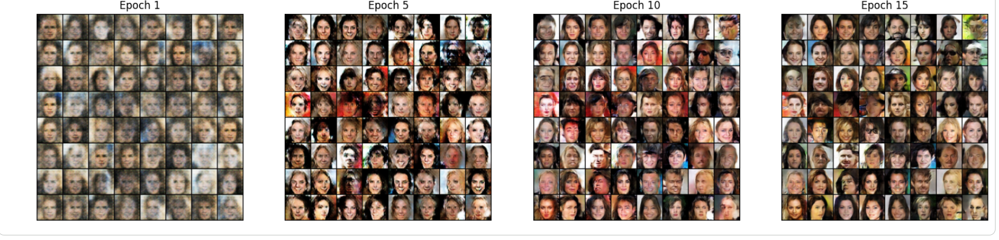
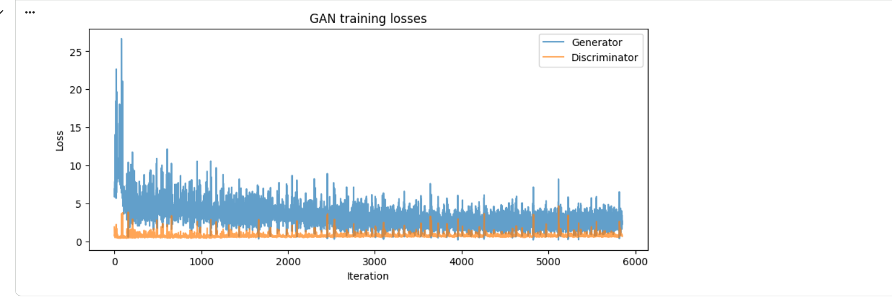

# GAN-Human-Face-Generation
# Realistic Human Face Generation using GAN

A Deep Convolutional Generative Adversarial Network (DCGAN) trained to generate synthetic human face images from random noise using PyTorch and the CelebA dataset.

## Project Overview

This project demonstrates how Generative Adversarial Networks can learn to generate realistic human face images through adversarial training.

The GAN consists of two neural networks:

- **Generator:** Generates synthetic face images from random noise.
- **Discriminator:** Distinguishes between real and generated images.

## Dataset

- **Dataset:** CelebA (CelebFaces Attributes Dataset)
- **Total Images:** 202,599
- **Image Size:** 64 × 64
- **Preprocessing:** Resizing and normalization to [-1, 1].

## Model Architecture & Training

- Architecture: DCGAN
- Framework: PyTorch
- Latent Dimension: 100
- Loss Function: BCEWithLogitsLoss
- Optimizer: Adam
- Learning Rate: 0.0002
- Number of Epochs: 15

## Training Progress

Comparison of generated faces at different training stages (Epochs 1, 5, 10, and 15).

## Final Generated Faces

The Generator produces 64 synthetic human face images from random noise.

## Training Loss Curve

Generator and Discriminator losses throughout training.

## Technologies Used

- Python
- PyTorch
- Torchvision
- NumPy
- Matplotlib
- CelebA Dataset

## Key Outcomes

- Implemented Generator and Discriminator networks.
- Trained a GAN using adversarial learning.
- Monitored training losses.
- Saved generated samples across 15 epochs.
- Compared generated images across different training stages.

## Repository Contents

- `Realistic_Human_Face_Generation_using_GAN1.ipynb` — Complete implementation and training notebook.
- `Epochs.png` — Training progress comparison.
- `Generated Faces.png` — Final generated samples.
- `loss_curve.png` — Training loss visualization.

